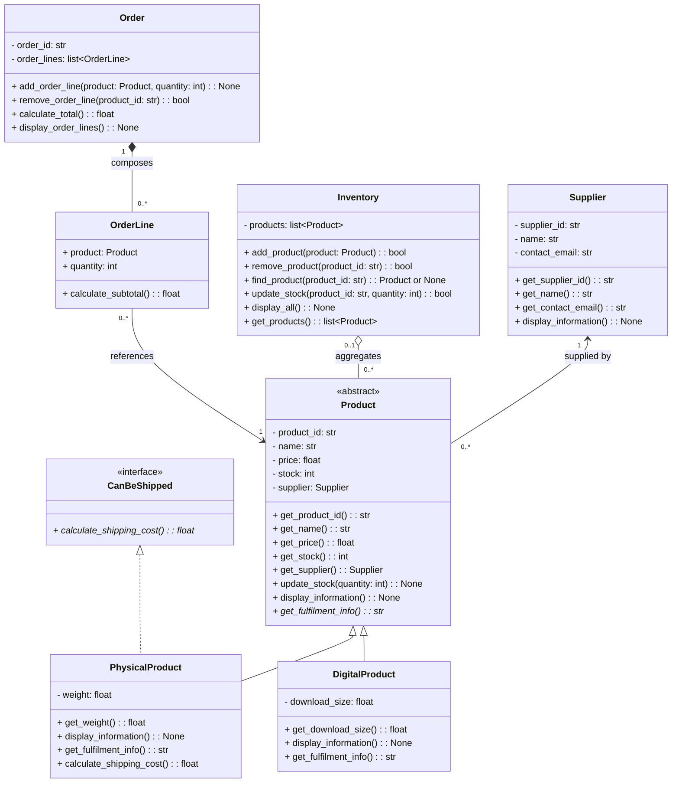

# Week 10 UML Class Diagram

`Supplier` and `Product` are associated, so each product can refer to one supplier while both objects have independent lifecycles. `Inventory` aggregates products: a product can exist outside an inventory and can be transferred. `Order` composes order lines: an order creates and manages its lines. Each order line refers to a product without owning it.

`Inventory` stores the abstract `Product` type. Its normal product operations call shared methods, so `PhysicalProduct` and `DigitalProduct` work through the same collection. `CanBeShipped` describes a capability implemented by physical products.
