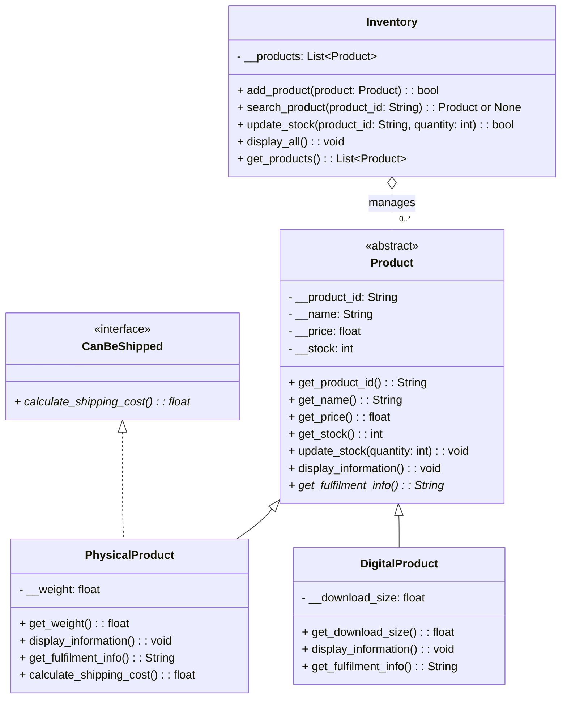

# Week 9 UML Class Diagram

`PhysicalProduct` inherits common product behavior and fulfills the `CanBeShipped` interface contract. `DigitalProduct` does not implement shipping. `main.py` handles JSON loading and saving.
